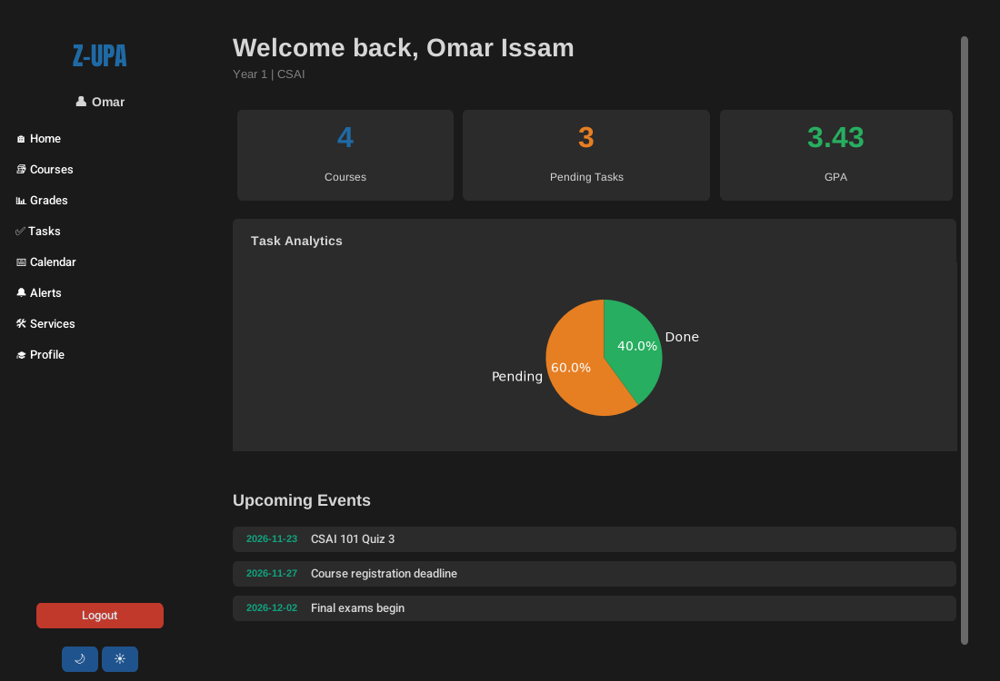
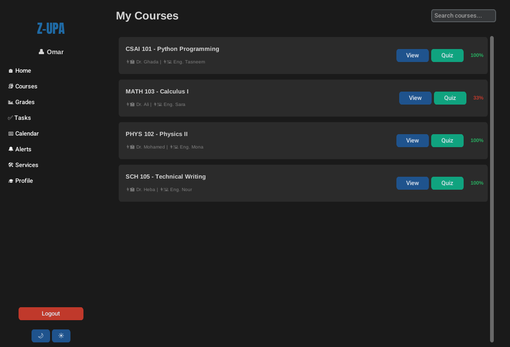
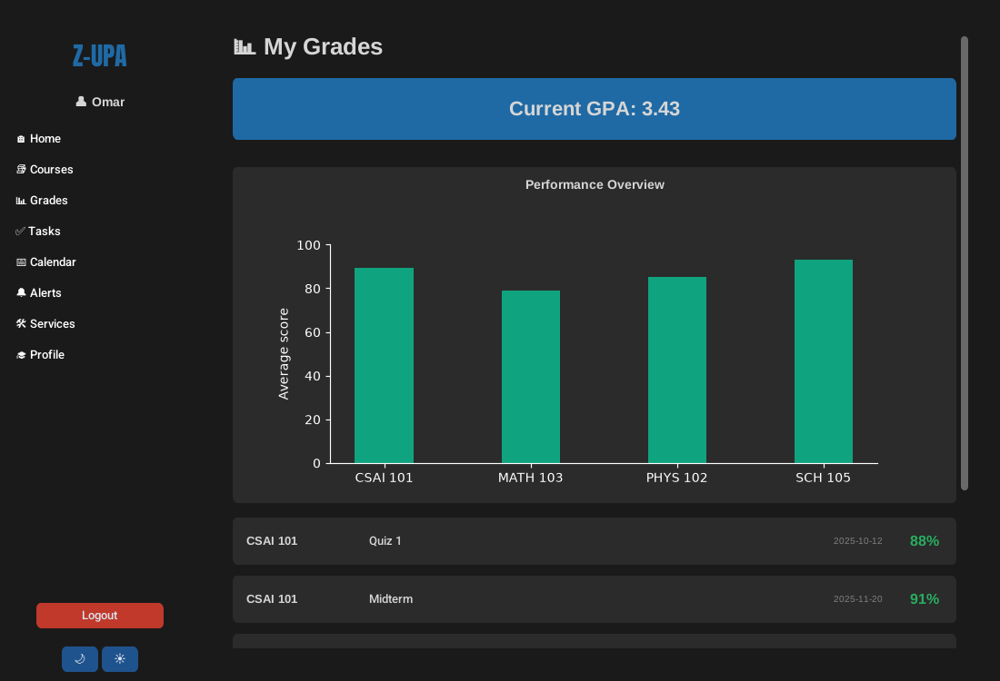
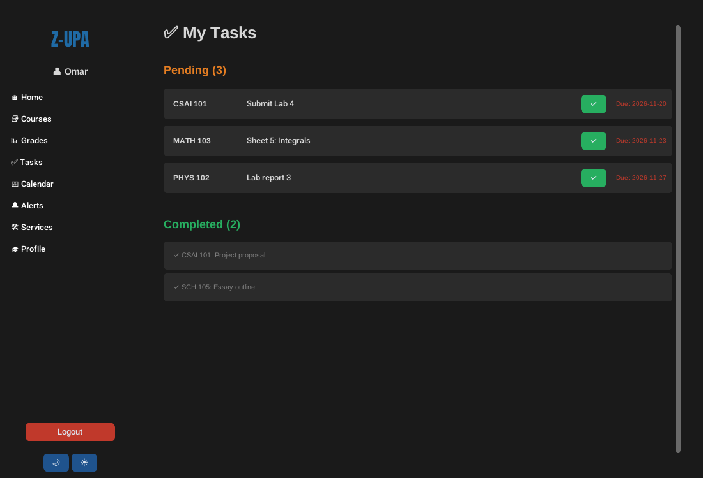
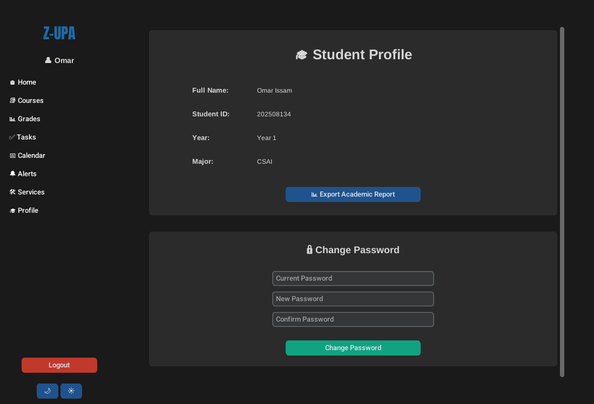
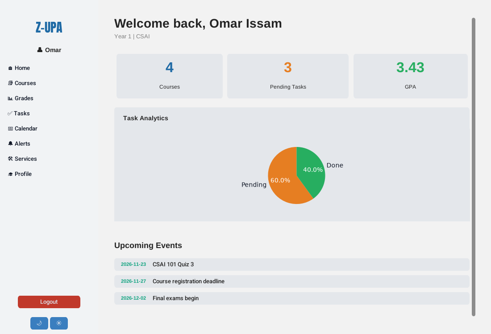
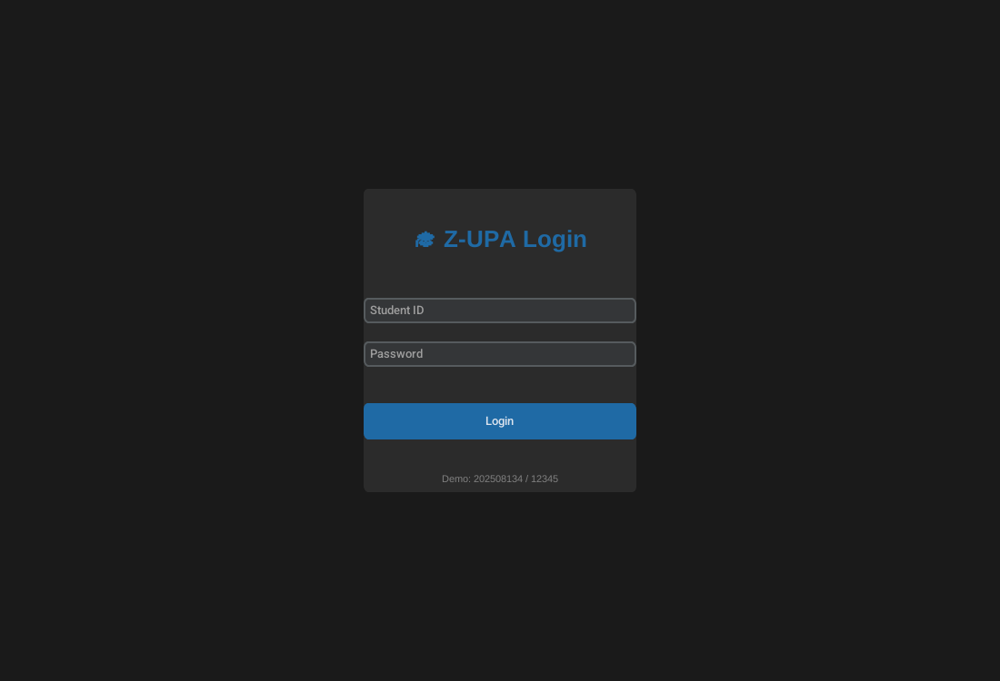

# Z-UPA Academic Hub

**A desktop student portal in Python: courses, grades and GPA, attendance, tasks, quizzes, calendar and student services in one CustomTkinter app.**

[](https://github.com/omar-issam-abdelhalim/Z-UPA-Academic-Hub/actions/workflows/ci.yml)


[](./LICENSE)

Final project for the **Python Programming** course, School of Computational Sciences and Artificial Intelligence (CSAI), January 2026. The full written report is in [`docs/project-report.pdf`](./docs/project-report.pdf).



---

## Why

A student's semester is spread across a learning platform, a grades portal and separate to-do apps. Z-UPA brings the everyday pieces into one desktop window: what you're enrolled in, how you're doing, what's due, and where to get help.

## Features

| Area | What it does |
|---|---|
| **Login & profile** | Student ID / password login, profile page, password change with current-password check. |
| **Dashboard** | GPA, course count and pending tasks at a glance; a task-completion chart; the next upcoming events. |
| **Courses** | Courses for the student's year, live search, per-course attendance rate (shown in red below 75%), lecture links, lab PDFs and assignments. |
| **Quizzes** | Multiple-choice quiz per course, instant scoring, results saved and exportable as a personal report. |
| **Grades** | GPA on a 4.0 scale, a per-course average bar chart and the full list of assessments. |
| **Tasks** | Pending and completed tasks with due dates; one click to mark a task done. |
| **Calendar & alerts** | Upcoming academic events and notifications (broadcast to everyone or addressed to one student). |
| **Services** | University services and events, and a complaint form with timestamped logging. |
| **Themes** | Dark and light themes; the choice is saved and restored on the next launch. |

## Screenshots

| Courses | Grades |
|---|---|
|  |  |

| Tasks | Profile |
|---|---|
|  |  |

| Light theme | Login |
|---|---|
|  |  |

## Getting started

Requires Python 3.10+ with Tkinter (included in the python.org installers; on Debian/Ubuntu run `sudo apt install python3-tk`).

```bash
git clone https://github.com/omar-issam-abdelhalim/Z-UPA-Academic-Hub.git
cd Z-UPA-Academic-Hub
python -m venv .venv
# Windows: .venv\Scripts\activate    macOS/Linux: source .venv/bin/activate
pip install -r requirements.txt
python main.py
```

**Demo login:** Student ID `202508134`, password `12345`.

On first launch the app creates a `data/` folder next to `main.py` and seeds it with demo data. Delete that folder to reset everything.

## How it's built

```
main.py
├── Data layer      plain functions that read and write comma-separated files in data/
│                   (students, courses, grades, attendance, tasks, calendar, notifications, results)
├── Logic           pure functions: calc_gpa, calc_score, calc_attendance_rate, filter/search courses
└── UI              ZUPA_App (CustomTkinter): one method per screen, a shared sidebar,
                    Matplotlib charts embedded with FigureCanvasTkAgg
```

- **Separation of concerns:** the calculations and file access are plain functions with no GUI code, so they are tested without opening a window.
- **Exact record ownership:** every record's student ID is compared exactly, so one student never sees another student's grades, attendance or messages.
- **Theme-aware charts:** surface colors are light/dark pairs; Matplotlib charts pick the matching pair and are redrawn when the theme changes.
- **Cross-platform:** data paths are resolved relative to the script, and files open with the platform's default app on Windows, macOS and Linux.

## Tests

```bash
pip install pytest
python -m pytest -q
```

23 unit tests cover login and password change, per-student data isolation, task updates, GPA, quiz scoring, attendance rate, course search, report export and theme colors. Each test runs against its own temporary data folder. GitHub Actions runs them on every push.

## Limitations

This is a course project, not production software:

- Passwords are stored in plain text in `data/students.txt`. A real deployment would hash them (e.g. bcrypt or Argon2).
- Storage is comma-separated text files, so a comma inside a field (e.g. a task title) breaks that record. SQLite would remove this limit and add transactions.
- Course content (lecture links, labs, assignments) is sample data defined in code.
- There is no screen for adding tasks or grades; those come from the data files.

## License

[MIT](./LICENSE) © 2026 Omar Issam
